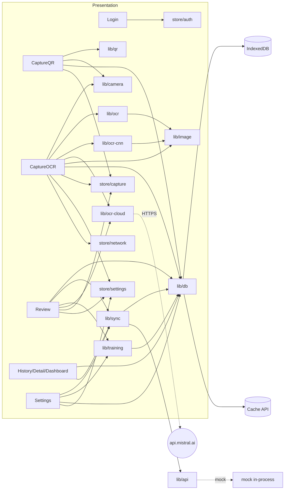
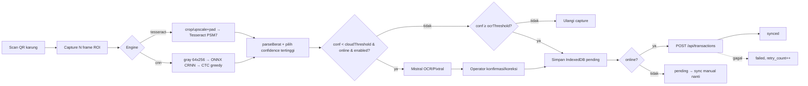

# 02 — Arsitektur Sistem

## 2a. Pola arsitektur

| Aspek | Temuan | Bukti | Label |
|---|---|---|---|
| Gaya utama | **Offline-first PWA** client-heavy: semua logika bisnis, OCR, dan penyimpanan berjalan di browser; server hanya tujuan sinkronisasi | `vite.config.ts:L9-61`, `src/lib/db.ts`, `src/lib/sync.ts` | [KODE] |
| Layering di PWA | 4 lapis: **Presentation** (`pages/`, `components/`) → **State** (`store/` Zustand) → **Service/Domain** (`lib/`) → **Persistence** (Dexie/IndexedDB + Cache API + localStorage) | struktur `src/` | [INFERENSI] dari pola import (mis. `pages/Review.tsx:L3-15` hanya memanggil `lib/` & `store/`) |
| OCR engine | **Strategy pattern** sederhana: 3 engine dengan kontrak sama `OCRResult {text, confidence, durationMs}` — Tesseract (`recognizeBlob`), CNN ONNX (`recognizeBlobCNN`), Cloud (`recognizeBlobCloud`); dipilih lewat setting | `src/types/ocr.ts:L1-10`, `src/lib/ocr-cnn.ts:L1-4` ("drop-in replacement"), `src/pages/CaptureOCR.tsx:L132-135` | [KODE] |
| Backend | **Belum ada**. `api.ts` memakai mock in-process bila `VITE_API_URL` kosong | `src/lib/api.ts:L9-12,L52-70` | [KODE] |
| ML pipeline | **Batch pipeline** skrip CLI berurutan (ETL → train → eval → export), terpisah dari aplikasi; artefak dipindah manual (`cp model.onnx …/public/models/`) | `…training…/README.md:L17-21` | [KODE] |
| App RN (C) | **Pipeline-of-iterations + voting aggregator** di atas engine ML Kit on-device | `src/ocr/runners.js:L19-51`, `pipelines/r35-tuned-trim.js:L354-361` | [KODE] |
| Hubungan 3 sub-proyek | (B) memproduksi model untuk (A) lewat file ONNX; (A) memproduksi dataset untuk (B) lewat ZIP "Mode Training". (C) berdiri sendiri (tidak berbagi kode/data dengan A/B) | `src/lib/training.ts:L65-161` ↔ `prepare.py:L74-124`; `export_onnx.py:L192-194` | [KODE] / [INFERENSI] untuk (C) |

## 2b. Modul, tanggung jawab, dependensi (PWA)

| Modul | Tanggung jawab | Bergantung pada | Bukti |
|---|---|---|---|
| `main.tsx` | Bootstrap React, pasang listener online/offline | `routes`, `store/network` | `src/main.tsx:L8-14` |
| `routes.tsx` | 8 rute + guard `RequireAuth` (cek token) | `store/auth`, `pages/*` | `src/routes.tsx:L13-35` |
| `lib/camera.ts` | `getUserMedia` (ideal 1920×1080, autofocus continuous), tangkap frame penuh / ROI tengah → JPEG | Web MediaDevices, Canvas | `src/lib/camera.ts:L1-100` |
| `lib/qr.ts` | Decode QR/DataMatrix/Code128/Code39/EAN13 dari video (ZXing, TRY_HARDER, 150 ms) | @zxing | `src/lib/qr.ts:L7-25,L40-87` |
| `lib/image.ts` | Preprocessing citra (red-emphasis gray, Otsu, invert, crop strip, upscale+padding) | Canvas | `src/lib/image.ts:L40-156` |
| `lib/ocr.ts` | Worker Tesseract singleton, pipeline recognize, `parseBerat` | tesseract.js, `image.ts`, `types/ocr` | `src/lib/ocr.ts:L6-152` |
| `lib/ocr-cnn.ts` | Load ONNX (WASM), preprocess 64×256, greedy CTC decode | onnxruntime-web, `image.ts` | `src/lib/ocr-cnn.ts:L8-163` |
| `lib/ocr-cloud.ts` | Fallback cloud Mistral OCR / Pixtral | fetch ke `api.mistral.ai` | `src/lib/ocr-cloud.ts:L22-212` |
| `lib/db.ts` | Skema Dexie, CRUD transaksi, blob via Cache API, estimasi storage | dexie, Cache API | `src/lib/db.ts:L1-93` |
| `lib/sync.ts` | Sinkronisasi satu/semua transaksi pending | `db.ts`, `api.ts` | `src/lib/sync.ts:L12-68` |
| `lib/api.ts` | HTTP wrapper + mock login/sync | `mocks/data` | `src/lib/api.ts:L1-70` |
| `lib/training.ts` | Simpan sampel training, export ZIP (`labels.csv` + `images/`) | jszip, `db.ts` | `src/lib/training.ts:L5-182` |
| `lib/utils.ts` | UUID, format tanggal, kode transaksi, `device_id` | localStorage | `src/lib/utils.ts:L1-56` |
| `store/auth.ts` | Token + profil operator (persist) | zustand/persist | `src/store/auth.ts:L18-30` |
| `store/capture.ts` | Draft wizard 3 langkah (QR → OCR → Review) + audit cloud | zustand | `src/store/capture.ts:L31-74` |
| `store/settings.ts` | Threshold, multi-frame, engine, model, training mode, API key Mistral (persist v7) | zustand/persist | `src/store/settings.ts:L56-109` |
| `store/network.ts` | Status `navigator.onLine` | window events | `src/store/network.ts:L8-22` |

Dependensi antar-modul (ringkas):



## 2c. Alur data end-to-end

**Mode produksi (transaksi)** — [KODE]:
1. Dashboard `MULAI TRANSAKSI` → `resetCapture()` → `/capture/qr` (`pages/Dashboard.tsx:L34-37`).
2. **Scan QR**: kamera belakang → ZXing decode kontinu; saat terdeteksi → getar 60 ms; tombol LANJUT → frame QR disimpan (maxWidth 720, q 0,8) ke Cache API → `setQR(code, blobId)` (`pages/CaptureQR.tsx:L29-68`). Alternatif: input manual kode QR (`L155-181`).
3. **Capture display**: ambil **N frame** (default 3, jeda 350 ms) dari ROI tengah 70%×35% (`pages/CaptureOCR.tsx:L23-24,L106-120`).
4. **OCR**: semua frame di-OCR paralel dengan engine terpilih (Tesseract/CNN) → `parseBerat` → buang frame tanpa angka → pilih frame dengan **confidence tertinggi** (`L129-161`).
5. Simpan foto frame terbaik + citra visualisasi preprocessing ke Cache API (`L163-173`); tulis draft (`L176`).
6. **Cloud fallback (opsional)**: jika diaktifkan, online, API key ada, dan confidence < threshold cloud → kirim frame ke Mistral (`L181-213`).
7. **Review**: tampilkan berat (LCD), confidence, 3 thumbnail; tombol SIMPAN **terkunci** bila sumber lokal & confidence < `ocrThreshold` (default 0,80) (`pages/Review.tsx:L63-65,L125-129,L569`). Bila hasil cloud: operator wajib konfirmasi/koreksi (`L68-71,L118-123`).
8. **Simpan**: buat record `Transaksi` (UUID, `TRX-…`, `sync_status='pending'`) → `db.transaksi.put` (`L132-162`).
9. **Sinkronisasi**: jika online, langsung `syncOne(id)` (fire-and-forget) (`L163`); jika gagal → `failed` + `retry_count++` (`lib/sync.ts:L37-45`).

**Mode training (pengumpulan dataset)** — [KODE]: langkah 1–5 sama; di Review, operator mengetik **ground truth** → `saveTrainingSample` ke tabel `training_samples` (bukan transaksi) (`pages/Review.tsx:L169-208`) → Settings → **EXPORT ZIP** (`pages/Settings.tsx:L42-55`) → diproses `prepare.py` → `train.py` → `export_onnx.py` → salin ONNX ke `public/models/` → rebuild PWA.



## 2d. Mekanisme offline & sinkronisasi

| Komponen | Implementasi | Bukti | Label |
|---|---|---|---|
| Service worker | `vite-plugin-pwa` mode default (**generateSW** Workbox), `registerType: 'autoUpdate'`, `injectRegister: 'auto'`; nonaktif saat dev | `vite.config.ts:L9-11,L58-60` | [KODE] |
| Precache | Pola `**/*.{js,css,html,png,svg,woff2,wasm,traineddata,onnx}`; batas file 60 MB (agar ONNX 46,6 MB ikut ter-cache) | `vite.config.ts:L29-30` | [KODE] |
| Runtime cache | `CacheFirst` untuk Google Fonts (2 domain) & `tessdata.projectnaptha.com` (model `eng` dari CDN), kedaluwarsa 1 tahun | `vite.config.ts:L31-56` | [KODE] |
| Fallback navigasi SPA | Netlify redirect `/* → /index.html` | `netlify.toml:L9-12`, `public/_redirects` | [KODE] |
| Model offline | `ssd` & `letsgodigital` dimuat dari `/tesseract-data` (lokal, `gzip:false`); `eng` dari CDN | `src/lib/ocr.ts:L27-34`, `pages/CaptureOCR.tsx:L74` | [KODE] |
| Deteksi jaringan | `navigator.onLine` + event `online`/`offline` | `src/store/network.ts:L8-22` | [KODE] |
| Antrian sync | **Tidak ada tabel antrian terpisah**; antrian = query `sync_status IN ('pending','failed')` | `src/lib/db.ts:L39-41` | [KODE] |
| Pemicu sync | (1) segera setelah simpan jika online; (2) tombol SYNC di History/Settings/Detail | `pages/Review.tsx:L163`, `pages/History.tsx:L50-57`, `pages/Settings.tsx:L68-78`, `pages/Detail.tsx:L35-42` | [KODE] |
| Auto-sync saat kembali online | **TIDAK ADA** (listener `online` hanya mengubah state, tidak memicu `syncAll`); Background Sync API tidak dipakai | `src/store/network.ts:L14-17`; `SPEC.md:L80` (out of scope) | [KODE] |
| Retry | Manual; `retry_count` bertambah tiap gagal, **tanpa backoff/limit** | `src/lib/sync.ts:L39-43` | [KODE] |
| Urutan sync | Sekuensial `for…of` | `src/lib/sync.ts:L57-65` | [KODE] |
| Konflik | **Tidak ada resolusi konflik**; ID dibuat klien (UUID v4) → berpotensi idempoten jika server memakai `id` sebagai kunci | `src/lib/utils.ts:L1-9`, `SPEC.md:L83` (out of scope) | [KODE]/[INFERENSI] |
| Blob foto | **Tidak ikut disinkronkan** — payload hanya metadata | `src/lib/sync.ts:L18-30` | [KODE] |
| Status `syncing` bisa "menggantung" | Jika app ditutup saat `syncing`, record tidak termasuk query pending (`pending`,`failed`) | `src/lib/sync.ts:L15`, `db.ts:L40` | [INFERENSI] |

## 2e. Integrasi eksternal

| Endpoint | Metode | Payload | Status | Bukti |
|---|---|---|---|---|
| `${VITE_API_URL}/api/auth/login` | POST | `{username, password}` → `{token, operator{code,name,entity_pengirim}}` | Mock bila env kosong | `src/lib/api.ts:L53-56`, `types/api.ts:L1-13` |
| `${VITE_API_URL}/api/transactions` | POST | `SyncTransaksiRequest` (11 field: id, nomor_kode_transaksi, user_operator_code, entity_pengirim, entity_penerima, qr_code_value, berat_kg, ocr_confidence, ocr_manual_edited, captured_at, device_id) → `{id, received_at}` | Mock, gagal acak 5% | `src/lib/api.ts:L45-49,L58-61`, `types/api.ts:L15-32` |
| `${VITE_API_URL}/api/ping` | GET | → `{ok}` | Mock; tidak dipanggil di halaman mana pun | `src/lib/api.ts:L63-69` [KODE: grep tidak menemukan pemanggil] |
| `https://api.mistral.ai/v1/ocr` | POST | `{model:'mistral-ocr-latest', document:{type:'image_url', image_url:dataURL}}`, Bearer API key | Opsional (default OFF) | `src/lib/ocr-cloud.ts:L89-109` |
| `https://api.mistral.ai/v1/chat/completions` | POST | Pixtral-12B, prompt JSON `{"value":"X.XXX"}`, `temperature 0`, `max_tokens 100` | Opsional | `src/lib/ocr-cloud.ts:L115-155` |
| `https://api.mistral.ai/v1/models` | GET | ping API key | fungsi ada, tidak dipakai UI | `src/lib/ocr-cloud.ts:L202-212` |
| Google Fonts, tessdata CDN | GET | aset statis | | `index.html:L14-19`, `vite.config.ts:L31-55` |
| MSW handlers | — | `mocks/handlers.ts` ada tetapi **tidak di-start** di `main.tsx` | kode mati | `src/mocks/browser.ts`, `src/main.tsx:L1-14` |

(C) App RN: **tidak ada integrasi jaringan**; OCR on-device ML Kit (`src/ocr/lib/textRecognition.native.js:L1-6`). Varian web memakai Tesseract `eng` PSM 6 (`textRecognition.web.js:L4-16`). [KODE]

## 2f. Diagram

### Komponen

```mermaid
graph TB
  subgraph Device["Smartphone operator (browser Chrome/Safari)"]
    subgraph PWA["PWA Analisa Timbang (React+TS)"]
      UI[Pages & Components]
      ST[Zustand stores]
      SVC[lib: camera · qr · image · ocr · ocr-cnn · ocr-cloud · sync · training]
    end
    SW[Service Worker Workbox<br/>precache app shell + WASM + .traineddata + .onnx]
    IDB[(IndexedDB<br/>transaksi · training_samples)]
    CA[(Cache API<br/>analisa-images-v1)]
    LS[(localStorage<br/>auth · settings · device_id)]
    WASM1[Tesseract.js WASM worker]
    WASM2[onnxruntime-web WASM]
  end
  UI --> ST --> SVC
  SVC --> WASM1 & WASM2
  SVC --> IDB & CA & LS
  SW -.serve offline.-> PWA
  SVC -. POST /api/transactions .-> BE[(Backend — BELUM ADA, mock)]
  SVC -. opsional .-> MS((Mistral API))

  subgraph Lab["Workstation ML (Mac M2 Pro / Colab)"]
    GEN[generate_synthetic.py] --> PREP[prepare.py]
    ZIP[ZIP export Mode Training] --> PREP
    PREP --> TR[train.py / train_transfer.py] --> EV[evaluate.py]
    TR --> EX[export_onnx.py tf2onnx opset13]
  end
  IDB -. export ZIP .-> ZIP
  EX -. salin manual cnn_*.onnx .-> SW
```

### Deployment

```mermaid
graph LR
  DEV[Developer] -->|npm run build| DIST[dist/ + sw.js + precache manifest]
  DIST -->|Netlify, NODE 20| CDN[Netlify CDN · HTTPS]
  CDN -->|first load online| PHONE[HP operator: install PWA]
  PHONE -->|offline setelah precache| PHONE
  PHONE -. sync saat online .-> API[Backend API — TIDAK DITEMUKAN DI REPO]
  ML[Mac M2 Pro / Colab T4] -->|model.onnx| DEV
  RN[Expo dev build Android AVD / HP] --- NOTE[(C) app terpisah, tidak di-deploy ke store]
```

Catatan: URL Netlify produksi **tidak tercantum** (slide 10 masih placeholder "[masukkan URL Netlify Anda di sini]"). [KONFIRMASI]
