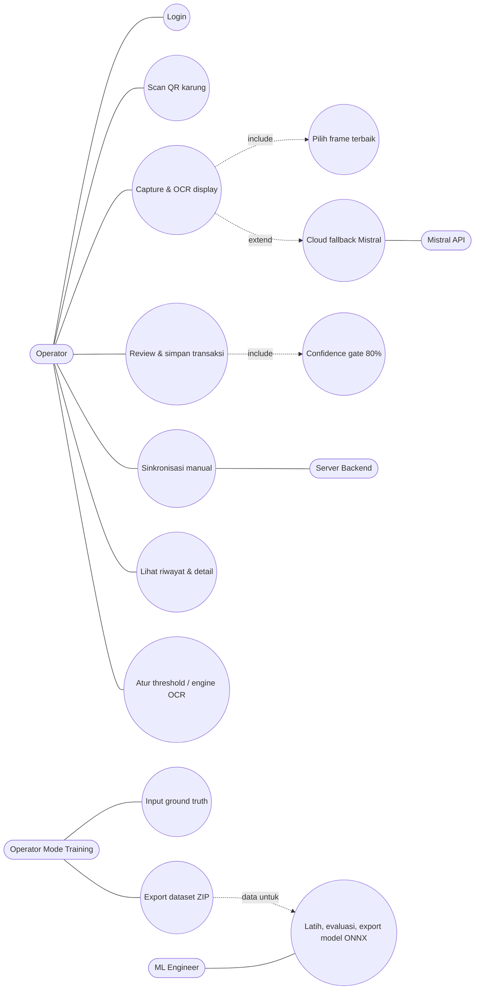
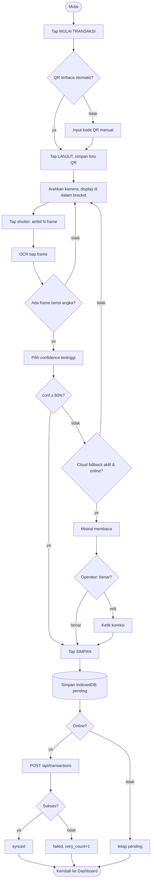
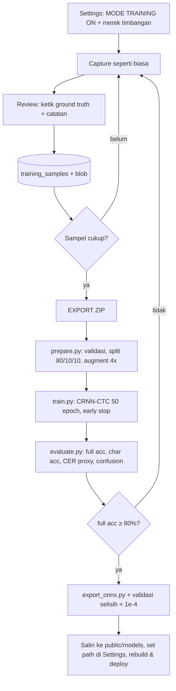
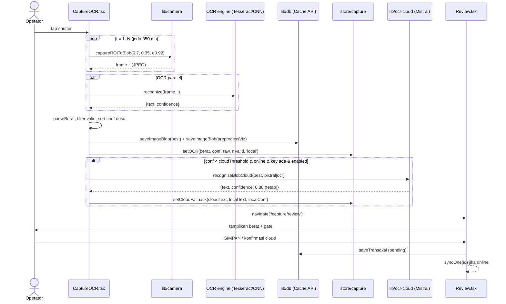

# 03 — Fitur & Kebutuhan Sistem

## 3a. Daftar fitur

### PWA (`poc-mobile-ocr-main`)
| # | Fitur | Deskripsi | File utama | Label |
|---|---|---|---|---|
| F-01 | Login operator | Form username/password (pra-isi `OP-2847`/`demo`), token disimpan persist | `pages/Login.tsx:L11-34`, `lib/api.ts:L30-43`, `store/auth.ts` | [KODE] |
| F-02 | Guard rute | Rute selain `/login` wajib token | `routes.tsx:L13-17` | [KODE] |
| F-03 | Dashboard | Sapaan operator, statistik total/pending/synced (live query), 5 transaksi terakhir, indikator offline, CTA "Mulai Transaksi" | `pages/Dashboard.tsx:L14-37` | [KODE] |
| F-04 | Scan QR karung | Deteksi otomatis multi-format, getar, simpan foto QR; fallback input manual | `pages/CaptureQR.tsx`, `lib/qr.ts` | [KODE] |
| F-05 | Capture display (shutter otomatis multi-frame) | N frame (1–5) ROI 70%×35%, pilih confidence tertinggi | `pages/CaptureOCR.tsx:L101-228` | [KODE] |
| F-06 | Crop manual | Editor kotak crop dengan drag & resize sudut | `components/ManualCropEditor.tsx`, `CaptureOCR.tsx:L230-246` | [KODE] |
| F-07 | Upload gambar (mode TEST) | Pilih file gambar → crop → OCR | `CaptureOCR.tsx:L248-264,L359-370` | [KODE] |
| F-08 | OCR multi-engine | Tesseract (ssd/letsgodigital/eng) atau CNN ONNX; dapat diganti di Settings | `lib/ocr.ts`, `lib/ocr-cnn.ts`, `pages/Settings.tsx:L319-376` | [KODE] |
| F-09 | Confidence gate | Tombol SIMPAN & SALIN terkunci bila confidence < threshold (default 80%) | `pages/Review.tsx:L63-65,L559-582` | [KODE] |
| F-10 | Cloud fallback Mistral | Otomatis/manual memanggil Mistral OCR/Pixtral saat confidence rendah; operator wajib konfirmasi/koreksi | `lib/ocr-cloud.ts`, `CaptureOCR.tsx:L181-213`, `Review.tsx:L84-123,L245-331` | [KODE] |
| F-11 | Review hasil | Layar LCD berat, confidence bar, thumbnail QR/display/"dilihat OCR", raw OCR output, salin ke clipboard | `pages/Review.tsx:L333-483` | [KODE] |
| F-12 | Simpan transaksi offline | Tulis ke IndexedDB, blob ke Cache API | `Review.tsx:L125-167`, `lib/db.ts` | [KODE] |
| F-13 | Sinkronisasi | Otomatis saat simpan (jika online) + manual (History/Settings/Detail) | `lib/sync.ts` | [KODE] |
| F-14 | Riwayat | Filter ALL/PENDING/SYNCED, dikelompokkan per tanggal, badge status | `pages/History.tsx` | [KODE] |
| F-15 | Detail transaksi (audit) | 11 field metadata, foto QR & display, jejak audit cloud | `pages/Detail.tsx:L55-84,L125-158` | [KODE] |
| F-16 | Mode Training | Toggle; di Review operator isi ground truth + catatan → simpan ke dataset | `Settings.tsx:L96-177`, `Review.tsx:L169-208,L485-520` | [KODE] |
| F-17 | Export dataset ZIP | `labels.csv` (13 kolom) + `images/` + README | `lib/training.ts:L65-161` | [KODE] |
| F-18 | Hapus semua sampel training | Dengan konfirmasi | `Settings.tsx:L57-66`, `lib/training.ts:L44-53` | [KODE] |
| F-19 | Pengaturan | Threshold OCR, multi-frame, model Tesseract, engine, path ONNX, kualitas gambar, API key Mistral, info perangkat, storage usage, logout | `pages/Settings.tsx` | [KODE] |
| F-20 | Installable PWA & offline | Manifest standalone portrait, SW precache | `vite.config.ts:L9-61`, `public/manifest.webmanifest` | [KODE] |

### App React Native (`poc-ocr-timbangan-master`)
| # | Fitur | File | Label |
|---|---|---|---|
| R-01 | Pilih model OCR (4 opsi: "Akurat & Cepat"=R35 default, "Hemat Waktu"=R30, "Mode Tajam"=R25, "Akurat Maksimal"=R39) | `src/models.js:L4-66` | [KODE] |
| R-02 | Ambil foto dari kamera atau galeri | `src/ScannerScreen.js:L20-46` | [KODE] |
| R-03 | Scan → nilai + satuan + detail per-iterasi & waktu | `src/ocr/runners.js:L19-51` | [KODE] |

## 3b. Aktor

| Aktor | Peran | Bukti | Label |
|---|---|---|---|
| **Operator timbangan** | Login, scan QR, capture, simpan, sinkron, lihat riwayat | `mocks/data.ts:L1-7`, `SPEC.md:L553-557` | [KODE] |
| **Operator/Admin pengumpul data (Mode Training)** | Mengisi ground truth & export ZIP | `types/training.ts:L1-5`, `SPEC.md:L824-826` | [KODE] |
| **ML Engineer** | Menjalankan pipeline Python, export model | `…training…/README.md:L154` | [KODE] |
| **Sistem Backend (server pusat)** | Menerima transaksi | `lib/api.ts:L58-61` (belum ada) | [INFERENSI] |
| **Layanan Cloud OCR (Mistral)** | Aktor sistem eksternal | `lib/ocr-cloud.ts` | [KODE] |
| Supervisor/auditor | Tersirat dari label "// AUDIT" dan jejak audit | `pages/History.tsx:L63`, `Detail.tsx:L88` | [INFERENSI] — tidak ada halaman/role khusus |

## 3c. Kebutuhan fungsional (reverse-engineering)

| ID | Kebutuhan | Bukti |
|---|---|---|
| KF-01 | Sistem harus mengautentikasi operator dengan kode operator & kata sandi, serta mempertahankan sesi setelah aplikasi ditutup. | `lib/api.ts:L53-56`, `store/auth.ts:L18-30` |
| KF-02 | Sistem harus menolak akses halaman transaksi tanpa sesi valid. | `routes.tsx:L13-17` |
| KF-03 | Sistem harus membaca kode QR/barcode karung secara otomatis dari kamera dan menyediakan input manual sebagai alternatif. | `pages/CaptureQR.tsx:L29-68,L155-181` |
| KF-04 | Sistem harus mengambil sejumlah N frame (1–5) dari area ROI display timbangan. | `CaptureOCR.tsx:L106-120`, `Settings.tsx:L395-408` |
| KF-05 | Sistem harus mengenali angka berat (digit 0–9 dan titik desimal) dari citra display secara on-device. | `types/ocr.ts:L25`, `lib/ocr-cnn.ts:L13` |
| KF-06 | Sistem harus memilih hasil pembacaan dengan confidence tertinggi dari beberapa frame yang valid. | `CaptureOCR.tsx:L145-161` |
| KF-07 | Sistem harus mencegah penyimpanan bila confidence OCR lokal di bawah ambang (default 80%) dan meminta operator mengulang. | `Review.tsx:L125-129,L578-582` |
| KF-08 | Sistem dapat (opsional) meminta pembacaan layanan cloud saat confidence rendah dan mewajibkan konfirmasi/koreksi operator. | `CaptureOCR.tsx:L181-213`, `Review.tsx:L127` |
| KF-09 | Sistem harus menyimpan transaksi (QR, berat, confidence, foto, waktu, operator, perangkat) secara lokal tanpa koneksi. | `Review.tsx:L132-162`, `types/transaksi.ts:L5-33` |
| KF-10 | Sistem harus mengirim transaksi pending ke server saat online dan memperbarui status (pending/syncing/synced/failed). | `lib/sync.ts:L12-46` |
| KF-11 | Sistem harus menampilkan riwayat transaksi dengan filter status dan pengelompokan per tanggal. | `pages/History.tsx:L23-39` |
| KF-12 | Sistem harus menampilkan detail transaksi beserta bukti foto dan jejak sumber OCR. | `pages/Detail.tsx:L55-84` |
| KF-13 | Sistem harus menyediakan mode pengumpulan data latih (citra + ground truth) terpisah dari transaksi produksi. | `Review.tsx:L169-208`, `db.ts:L16-19` |
| KF-14 | Sistem harus mengekspor dataset latih dalam format ZIP (`labels.csv` + `images/`) yang kompatibel dengan pipeline training. | `lib/training.ts:L65-161`, `prepare.py:L90-124` |
| KF-15 | Sistem harus memungkinkan pemilihan engine OCR dan model tanpa mengubah kode. | `store/settings.ts:L24,L35-36` |
| KF-16 | Pipeline ML harus membagi dataset 80/10/10 terstratifikasi panjang label dan mengaugmentasi data latih 4× per sampel. | `config.py:L39-44`, `prepare.py:L128-150` |
| KF-17 | Pipeline ML harus melatih model CRNN-CTC, mengevaluasi (full-string acc, char acc, edit distance, per-panjang, confusion matrix, latensi) dan mengekspor ke ONNX tervalidasi. | `train.py`, `evaluate.py:L100-203`, `export_onnx.py:L139-189` |

## 3d. Kebutuhan non-fungsional yang terlihat

| ID | Kategori | Kebutuhan | Bukti | Label |
|---|---|---|---|---|
| KNF-01 | Ketersediaan offline | 100% operasional offline setelah first load | `SPEC.md:L66`, `vite.config.ts:L29` | [KODE] |
| KNF-02 | Akurasi | Full-string accuracy ≥ 80% (hard requirement); char acc ≥ 99% | `SPEC.md:L772`, `…training…/README.md:L119-127` | [KODE] |
| KNF-03 | Integritas audit | "No manual input" untuk digit berat — operator harus retake | `SPEC.md:L773`, `Review.tsx:L350-353` | [KODE] (namun dilanggar oleh jalur koreksi cloud, lihat 07) |
| KNF-04 | Privasi / on-device | Cloud AI dilarang | `SPEC.md:L774`, `DEPLOYMENT.md:L22` | [KODE] (dilonggarkan oleh fitur Mistral opsional) |
| KNF-05 | Kinerja | Capture flow end-to-end < 30 s; OCR < 3 s/citra; inferensi CNN < 200 ms di HP; load offline < 2 s | `SPEC.md:L104,L137-138`, `…training…/README.md:L125` | [KODE] (target) |
| KNF-06 | Ukuran model | ONNX ~45 MB diterima untuk precache; batas precache 60 MB | `…training…/README.md:L126`, `vite.config.ts:L30` | [KODE] |
| KNF-07 | Storage | 200 blob foto tanpa quota error, total < 50 MB; foto < 200 KB | `SPEC.md:L108,L120,L196` | [KODE] (target) |
| KNF-08 | Kompatibilitas | Chrome 100+, Safari 16+, Edge 100+; Android 10+; HTTPS wajib untuk kamera; viewport 360–430 px; orientasi portrait | `README.md:L31-32`, `SPEC.md:L67,L449`, `manifest.webmanifest:L8` | [KODE] |
| KNF-09 | Usability | Touch target ≥ 48 px; tema gelap/terang industrial; umpan getar | `SPEC.md:L69`, `CaptureQR.tsx:L39` | [KODE] |
| KNF-10 | Keamanan | **Belum**: kredensial hardcoded, token mock, API key di localStorage | `mocks/data.ts:L4`, `settings.ts:L69`, `SPEC.md:L39` | [KODE] |
| KNF-11 | Keterlacakan | Setiap transaksi menyimpan `device_id`, `app_version`, `ocr_source`, `ocr_raw_text`, foto bukti | `types/transaksi.ts:L19-32` | [KODE] |
| KNF-12 | Reproducibility ML | Seed 42 untuk TF/NumPy/split | `config.py:L47`, `train.py:L29-30` | [KODE] |

## 3e. Diagram

### Use case

### Activity — Transaksi penimbangan (produksi)

### Activity — Pengumpulan data & siklus pelatihan model

### Sequence — Capture OCR multi-frame + cloud fallback (alur paling kompleks)

## 3f. Daftar screen/halaman

| Screen | Rute | Fungsi | File |
|---|---|---|---|
| Login | `/login` | Autentikasi operator | `pages/Login.tsx` |
| Dashboard | `/dashboard` | Ringkasan & mulai transaksi | `pages/Dashboard.tsx` |
| Scan QR (Step 1/3) | `/capture/qr` | Deteksi QR karung / input manual | `pages/CaptureQR.tsx` |
| Capture Timbangan (Step 2/3) | `/capture/ocr` | Kamera + bracket ROI, shutter, crop manual, upload | `pages/CaptureOCR.tsx` |
| Crop Manual (overlay) | (state di Step 2) | Pilih area display | `components/ManualCropEditor.tsx` |
| Review (Step 3/3) | `/capture/review` | Hasil OCR, gate, cloud, ground truth (training) | `pages/Review.tsx` |
| Riwayat | `/history` | Daftar & filter, sync | `pages/History.tsx` |
| Detail | `/history/:id` | Metadata audit + foto | `pages/Detail.tsx` |
| Pengaturan | `/settings` | Training, sync, storage, cloud, engine, OCR, image, perangkat | `pages/Settings.tsx` |
| (C) Scanner | layar tunggal | Pilih model, kamera/galeri, scan, detail iterasi | `poc-ocr-timbangan-master/src/ScannerScreen.js` |

Catatan: SPEC menyebut "mockup 12 screens" (`README.md:L239`) — file mockup **TIDAK DITEMUKAN DI REPO**; screenshot aplikasi juga tidak ada (`SPEC.md:L623` belum dicentang). [KONFIRMASI]
