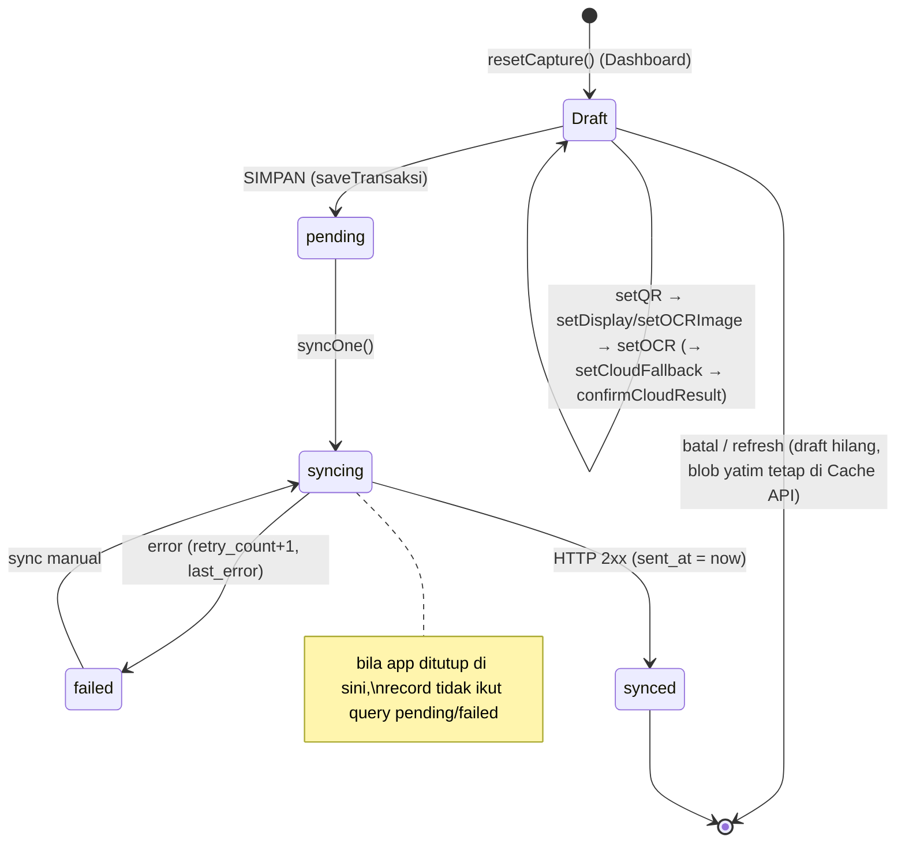
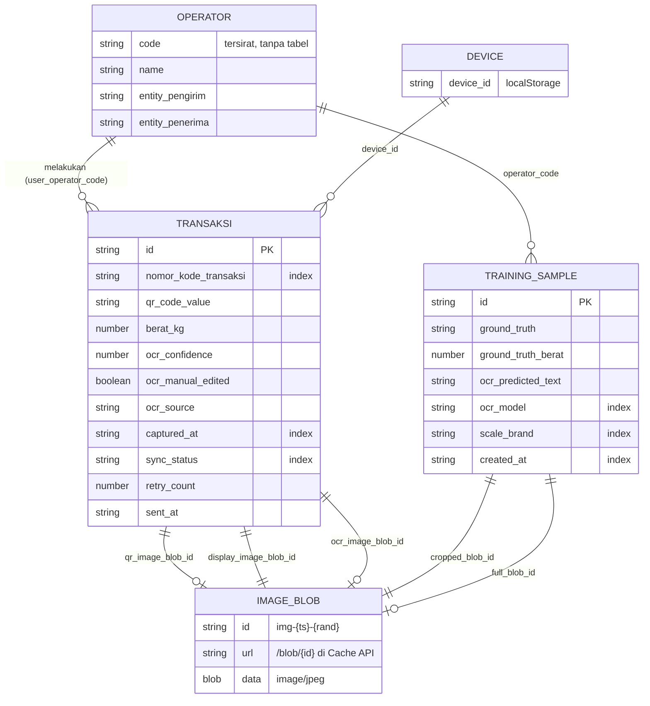
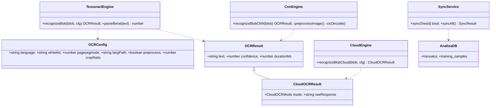

# 04 — Model Data & Penyimpanan

## 4a. Ringkasan media penyimpanan

| Media | Nama | Isi | Bukti |
|---|---|---|---|
| IndexedDB (Dexie) | DB `analisa-timbang`, **versi skema 2** | tabel `transaksi`, `training_samples` | [KODE] `src/lib/db.ts:L7-21` |
| Cache API | `analisa-images-v1`, key `/blob/{imgId}` | blob JPEG (foto QR, foto display, visualisasi preprocessing, salinan untuk training) | [KODE] `src/lib/db.ts:L5,L60-85` |
| localStorage | `analisa-auth` | `{token, operator{code,name,entity_pengirim,entity_penerima}}` | [KODE] `src/store/auth.ts:L18-30` |
| localStorage | `analisa-settings` (versi 7) | 13 preferensi termasuk `mistralApiKey` | [KODE] `src/store/settings.ts:L56-109` |
| localStorage | `device_id` | UUID perangkat | [KODE] `src/lib/utils.ts:L46-54` |
| Memori (Zustand, non-persist) | `useCapture` | `TransaksiDraft` + `cloudModeUsed`, `cloudRawResponse` | [KODE] `src/store/capture.ts:L31-74` |
| File (pipeline ML) | `labels.csv` + `images/` | dataset | [KODE] `lib/training.ts:L73-75`, `prepare.py:L191-196` |

## 4b. Skema & field

### Tabel `transaksi` (IndexedDB)
Primary key: `id`; index: `nomor_kode_transaksi`, `sync_status`, `captured_at` — [KODE] `db.ts:L14,L17`. Interface `Transaksi` — [KODE] `src/types/transaksi.ts:L5-33`.

| Field | Tipe | Keterangan | Sumber nilai |
|---|---|---|---|
| `id` | string (PK) | UUID v4 klien | `utils.ts:L1-9`, `Review.tsx:L132` |
| `nomor_kode_transaksi` | string (index) | `TRX-{kodeOperator}-{YYYYMMDDhhmmss}-{4 char acak}` | `utils.ts:L39-44` |
| `user_operator_code` | string | kode operator | `Review.tsx:L136` |
| `user_operator_name` | string | nama operator | `L137` |
| `entity_pengirim` | string | dari profil login | `L138` |
| `entity_penerima` | string | **hardcoded** `'PT MITRA LOGISTIK'` saat login | `Login.tsx:L26` |
| `qr_code_value` | string | isi QR / input manual | `CaptureQR.tsx:L54,L66` |
| `qr_image_blob_id` | string | ref Cache API; bila input manual berisi `manual-{ts}` (tanpa blob) | `CaptureQR.tsx:L57-65` |
| `display_image_blob_id` | string | ref foto frame terbaik | `CaptureOCR.tsx:L163-164` |
| `ocr_image_blob_id` | string | ref citra visualisasi preprocessing | `CaptureOCR.tsx:L167-170` |
| `berat_kg` | number | hasil `parseBerat` (dibulatkan 2 desimal) | `ocr.ts:L138-144` |
| `ocr_confidence` | number 0–1 | confidence engine | `CaptureOCR.tsx:L176` |
| `ocr_manual_edited` | boolean | true jika operator mengoreksi hasil cloud | `store/capture.ts:L64-72` |
| `ocr_raw_text` | string \| null | teks mentah OCR | `store/capture.ts:L46` |
| `ocr_frame_count` | number | jumlah frame **valid** (bukan N yang diambil) | `CaptureOCR.tsx:L176` |
| `ocr_source` | `'local' \| 'cloud-mistral' \| 'cloud-confirmed'` | sumber pembacaan | `types/transaksi.ts:L3` |
| `cloud_predicted_text` | string \| null | teks cloud | `store/capture.ts:L56` |
| `local_predicted_text` | string \| null | teks lokal (audit) | `L57` |
| `local_confidence` | number \| null | confidence lokal (audit) | `L58` |
| `captured_at` | string ISO-8601 (index) | waktu OCR selesai | `CaptureOCR.tsx:L176` |
| `sent_at` | string \| null | waktu sukses sync | `sync.ts:L31-35` |
| `sync_status` | `'pending' \| 'syncing' \| 'synced' \| 'failed'` (index) | status | `types/transaksi.ts:L1` |
| `retry_count` | number | jumlah gagal sync | `sync.ts:L41` |
| `last_error` | string \| null | pesan error terakhir | `sync.ts:L42` |
| `device_id` | string | UUID perangkat | `Review.tsx:L158` |
| `app_version` | string | `'0.1.0'` | `utils.ts:L56` |

### Tabel `training_samples` (IndexedDB, ditambahkan di skema v2)
PK `id`; index `ocr_model`, `scale_brand`, `created_at` — [KODE] `db.ts:L18`. Interface — [KODE] `types/training.ts:L6-27`.

| Field | Tipe | Keterangan |
|---|---|---|
| `id` | string (PK) | `crypto.randomUUID()` (`training.ts:L8`) |
| `cropped_blob_id` | string | **salinan** blob display (lifecycle terpisah) (`Review.tsx:L176-177`, `training.ts:L178-182`) |
| `full_blob_id` | string \| null | saat ini = `display_image_blob_id` yang sama (bukan foto utuh) (`Review.tsx:L178`) |
| `ocr_predicted_text` / `ocr_predicted_berat` / `ocr_confidence` | string/number/number \| null | prediksi saat capture (untuk benchmark) |
| `ocr_model` | string | diisi `ocrLanguage` (ssd/letsgodigital/eng) **walaupun engine = CNN** (`Review.tsx:L189`) — [KODE] potensi label keliru |
| `ground_truth` | string | teks yang diketik operator |
| `ground_truth_berat` | number | `parseFloat` ground truth, default 0 (`Review.tsx:L181`) |
| `scale_brand` | string \| null | dari Settings |
| `notes` | string \| null | catatan kondisi (cahaya, sudut) |
| `operator_code`, `device_id`, `app_version`, `created_at` | string | metadata |

### Draft wizard (non-persist) — `TransaksiDraft`
14 field; subset dari `Transaksi` yang nullable (`types/transaksi.ts:L35-50`), nilai awal `EMPTY_DRAFT` (`L52-67`). Hilang bila halaman di-refresh (tidak persist). [KODE]

### Settings (localStorage `analisa-settings`)
| Field | Default | Bukti |
|---|---|---|
| `ocrThreshold` | 0.80 (dipaksa 0.80 saat migrasi versi) | `settings.ts:L59,L92` |
| `imageQuality` / `imageMaxWidth` | 0.92 / 1280 (ditampilkan; **tidak dipakai** saat capture, yang dipakai konstanta 0.92 di `CaptureOCR.tsx:L116`) | `settings.ts:L60-61` [INFERENSI dari grep pemakaian] |
| `multiFrameCount` | 3 (1–5) | `L62`, `Settings.tsx:L399-406` |
| `ocrLanguage` | `'ssd'` | `L63` |
| `trainingMode` | false (di-reset false saat migrasi) | `L64,L97` |
| `trainingScaleBrand` | `''` | `L65` |
| `ocrEngine` | `'tesseract'` | `L66` |
| `cnnModelPath` | `'/models/cnn_synth_v1.onnx'` | `L67` |
| `cloudFallbackEnabled` | false | `L68` |
| `mistralApiKey` | `''` (disimpan plaintext) | `L69` |
| `cloudFallbackThreshold` | 0.80 (slider 0.5–0.80) | `L70`, `Settings.tsx:L258-266` |
| `cloudOcrMode` | `'pixtral'` | `L71` |

### Skema API (kontrak ke backend)
`LoginRequest{username,password}` → `LoginResponse{token, operator{code,name,entity_pengirim}}`; `SyncTransaksiRequest` (11 field) → `SyncTransaksiResponse{id, received_at}`; `ApiError{error, code?}` — [KODE] `src/types/api.ts:L1-37`.
Catatan: payload sync **tidak memuat** `ocr_source`, `cloud_predicted_text`, `ocr_raw_text`, foto, maupun `app_version` → jejak audit cloud tidak sampai ke server. [KODE] `sync.ts:L18-30`

### Skema dataset (file)
| File | Kolom | Bukti |
|---|---|---|
| Export PWA `labels.csv` | `id, crop_filename, full_filename, ground_truth, berat_kg, ocr_predicted, ocr_confidence, ocr_model, scale_brand, notes, operator, device_id, timestamp` (13) | `lib/training.ts:L73-75` |
| Sintetis `labels.csv` | 13 kolom sama; `ocr_model='synthetic'`, `scale_brand='SYNTHETIC-7SEG'` | `generate_synthetic.py:L275-289` |
| Prepared `{train,val,test}/labels.csv` | `filename, ground_truth, is_augmented, source_id, scale_brand, ocr_predicted, ocr_model` (7) | `prepare.py:L165-189` |
| `stats.json` | distribusi panjang label, karakter, merek per split + config | `prepare.py:L272-290` |
| Artefak model | `best.h5`, `final.h5`, `inference.h5`, `history.json`, `training.csv`, `training_curves.png`, `evaluation_report.json`, `failures.csv`, `confusion_matrix.png`, `onnx_validation.json` | `train.py:L275,L295,L319-324`, `evaluate.py:L152-203`, `export_onnx.py:L186` — **semua TIDAK DITEMUKAN DI REPO** |

### Relasi
- `Transaksi` 1 — 0..1 blob QR, 1 blob display, 1 blob viz (referensi string ke Cache API, **tanpa foreign key/cascade**). [KODE]
- `TrainingSample` 1 — 1 blob cropped (salinan) + 0..1 blob full (dibagi dengan draft). [KODE]
- `Transaksi` N — 1 Operator, N — 1 Device (tersirat, tidak ada tabel master). [INFERENSI]
- Tidak ada relasi `Transaksi` ↔ `TrainingSample` (mode eksklusif). [KODE] `Review.tsx:L537-576`

## 4c. Siklus hidup data

### Transaksi

Rincian:
1. **Dibuat**: draft di memori (`store/capture.ts`), blob foto langsung ditulis ke Cache API saat capture — bahkan sebelum disimpan (`CaptureOCR.tsx:L163-173`). Setiap retake menghasilkan blob baru; blob lama **tidak dihapus** → potensi blob yatim. [INFERENSI dari tidak adanya pemanggilan `deleteImageBlob` untuk transaksi; grep hanya di `training.ts:L38-49`]
2. **Disimpan lokal**: `db.transaksi.put` status `pending` (`Review.tsx:L155,L162`).
3. **Disinkron**: metadata saja (foto tetap di perangkat).
4. **Status akhir**: `synced`; **tidak ada** penghapusan/retensi/arsip otomatis. Rencana "cleanup synced data" hanya di SPEC (`SPEC.md:L150`). [KODE]

### Training sample
dibuat di Review (Mode Training) → `training_samples` + blob salinan → diekspor ZIP (tidak mengubah status; tidak ada flag "sudah diekspor") → dapat dihapus massal (menghapus blob terkait) (`training.ts:L34-53`). [KODE]

### Dataset di pipeline ML
ZIP → ekstrak → filter (file ada, label berisi digit) → split terstratifikasi → augmentasi train ×4 → `data/prepared/` → training → model `.h5` → ONNX → `public/models/` PWA. [KODE] `prepare.py:L74-150`

## 4d. ERD / class diagram

