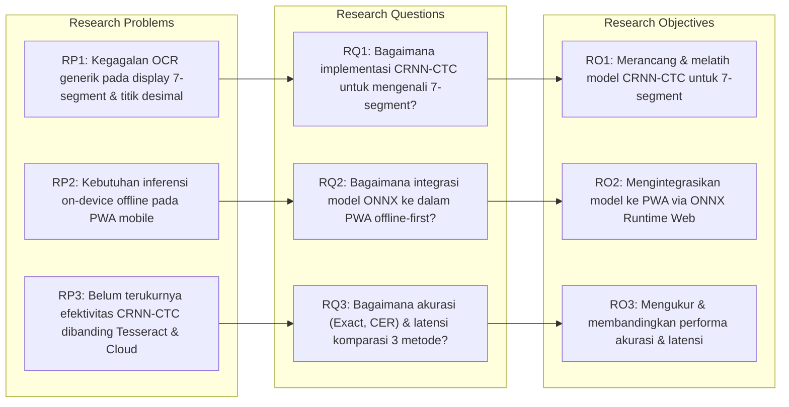
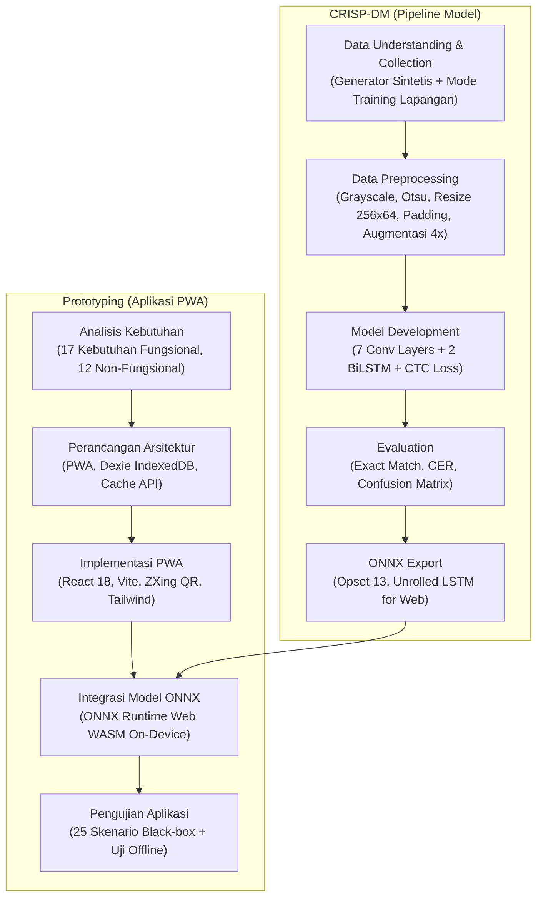

# RANGKUMAN OUTLINE TUGAS AKHIR (SKRIPSI)
## Program Studi Teknik Informatika — Fakultas Teknik Universitas Siliwangi

---

### IDENTITAS USULAN PENELITIAN
* **Nama Mahasiswa:** Hilma Amalia Putri
* **Program Studi:** S1 Teknik Informatika
* **Fakultas:** Teknik, Universitas Siliwangi
* **Kelompok Bidang Keahlian:** Informatika dan Sistem Inteligen (ISI)
* **Bentuk Penelitian:** Pengembangan Sistem dengan Studi Komparasi (Benchmarking Metode)
* **Acuan Format:** *Pedoman Pelaksanaan KP dan TA Jurusan Teknik Informatika Unsil (2017)*

---

### JUDUL PENELITIAN (DIREKOMENDASIKAN)
> **"IMPLEMENTASI METODE CONVOLUTIONAL RECURRENT NEURAL NETWORK (CRNN) DAN CONNECTIONIST TEMPORAL CLASSIFICATION (CTC) UNTUK PENGENALAN ANGKA DISPLAY SEVEN SEGMENT PADA APLIKASI PENCATATAN TIMBANGAN DIGITAL BERBASIS PROGRESSIVE WEB APP"**

*Pola Judul:* "Implementasi Metode [CRNN-CTC] terhadap [Objek Display Seven Segment Timbangan] dengan Luaran Aplikasi [PWA Offline-First]".

---

## 1. LATAR BELAKANG DAN URGENSI PENELITIAN

1. **Permasalahan Operasional Lapangan:**
   Proses pencatatan hasil penimbangan komoditas/karung di pabrik dan gudang logistik sebagian besar masih dilakukan secara manual dengan menulis angka di buku/kertas form. Cara ini lambat, rentan salah catat (*human error* seperti tertukarnya angka atau pergeseran koma), serta tidak memiliki bukti visual (*audit trail*) untuk verifikasi saat terjadi selisih stok.
2. **Keterbatasan Infrastruktur Jaringan (Offline Requirement):**
   Area penimbangan di pabrik atau gudang sering berada di titik lemah sinyal (*dead zone*) atau tanpa jaringan internet. Sistem pencatatan digital wajib bekerja **100% offline di perangkat bergerak (on-device edge AI)** tanpa bergantung pada server komputasi cloud.
3. **Kegagalan OCR Generik pada Display Seven Segment:**
   Optical Character Recognition konvensional berbasis OCR engine generik (seperti Tesseract OCR dan Google ML Kit) dirancang untuk teks dokumen tercetak. Karakter *seven segment display* (LED/LCD) memiliki segmen garis putus-putus dan geometri kaku yang membuat OCR generik gagal total:
   - Pengujian awal Tesseract.js menghasilkan **0 dari 12 pengujian yang bernilai tepat (0% exact match)** pada citra nyata display timbangan. Titik desimal sering hilang atau terbaca sebagai derau.
   - Confidence score Tesseract sering tinggi ($\ge 85\%$) meskipun hasil teksnya salah, sehingga berbahaya untuk validasi otomatis.
4. **Solusi Pendekatan Deep Learning CRNN-CTC:**
   Kombinasi *Convolutional Neural Network* (CNN) sebagai ekstraktor fitur visual citra dan *Bidirectional Long Short-Term Memory* (BiLSTM) sebagai pemodel sekuens urutan teks dengan fungsi *Connectionist Temporal Classification* (CTC) memungkinkan pengenalan deret angka secara *end-to-end* tanpa perlu segmentasi karakter per digit. Model ini diekspor ke format ONNX dan dijalankan langsung di browser menggunakan **ONNX Runtime Web (WebAssembly)** di dalam aplikasi *Progressive Web App* (PWA).

---

## 2. MATRIKS PENELITIAN (RP, RQ, RO)

Format matriks riset mengacu pada standar proposal usulan penelitian Informatika FT Unsil:

| Kode | Uraian |
| :--- | :--- |
| **RP1** | OCR generik berbasis dokumen (Tesseract/ML Kit) gagal mengenali karakter display 7-segment timbangan dan sering menghilangkan titik desimal ($0/12$ exact match). |
| **RQ1** | Bagaimana mengimplementasikan arsitektur *Convolutional Recurrent Neural Network* (CRNN) dan *Connectionist Temporal Classification* (CTC) untuk mengenali angka dan titik desimal pada citra display seven segment timbangan digital? |
| **RO1** | Mengembangkan dan melatih model deep learning CRNN-CTC menggunakan variasi data sintetis dan citra nyata agar mampu mengenali deret digit dan titik desimal timbangan digital secara akurat. |
| **RP2** | Lingkungan penimbangan industri membutuhkan sistem yang beroperasi penuh tanpa koneksi internet (*offline-first*) pada perangkat mobile operator, namun inferensi deep learning di browser sering terkendala beban komputasi dan ukuran model. |
| **RQ2** | Bagaimana mengintegrasikan model CRNN-CTC hasil pelatihan ke dalam aplikasi *Progressive Web App* (PWA) agar proses pengenalan angka dapat dieksekusi secara lokal (*on-device*) tanpa internet? |
| **RO2** | Menerapkan model deep learning ke dalam format ONNX dan mengintegrasikannya ke PWA menggunakan ONNX Runtime Web (WASM) didukung skema penyimpanan lokal IndexedDB (Dexie) dan Cache API. |
| **RP3** | Belum ada studi komparasi empiris yang membandingkan performa metode CRNN-CTC *on-device*, OCR generik konvensional (*Tesseract.js*), dan layanan OCR berbasis *cloud* (*Google Cloud Vision API*) pada domain display seven segment timbangan digital. |
| **RQ3** | Bagaimana perbandingan kinerja pengenalan (akurasi *exact match*, *Character Error Rate*, akurasi titik desimal) dan latensi komputasi antara metode CRNN-CTC on-device, Tesseract.js, dan Google Cloud Vision? |
| **RO3** | Melakukan evaluasi komparatif secara kuantitatif terhadap ketiga pendekatan OCR pada dataset citra display timbangan nyata yang sama serta menguji fungsionalitas aplikasi menggunakan *black-box testing*. |

---

## 3. BATASAN MASALAH

1. **Karakter Pengenalan:** Pengenalan dibatasi pada angka $0, 1, 2, 3, 4, 5, 6, 7, 8, 9$ dan tanda titik desimal (`.`), dengan panjang karakter maksimum 8 digit dalam 1 baris.
2. **Objek Display:** Display timbangan digital bertipe *seven segment* (LED merah/hijau atau LCD berlatar belakang kontras).
3. **Akuisisi Citra:** Citra diambil menggunakan kamera belakang ponsel pintar melalui area pandang tetap (*fixed Region of Interest* / ROI $70\% \times 35\%$) pada aplikasi PWA.
4. **Data Penelitian:** Dataset pelatihan terdiri atas dataset sintetis 7-segment yang digenerasi secara terprogram serta dataset foto nyata yang dikumpulkan menggunakan Mode Training pada aplikasi.
5. **Lingkungan Pengujian:** Aplikasi diuji pada browser Google Chrome berbasis sistem operasi Android.
6. **Ruang Lingkup Sistem:** Fokus pengembangan adalah aplikasi *client-side* PWA offline-first dan model OCR on-device. Sinkronisasi data ke server diuji menggunakan layanan API simulasi (*mock backend*).

---

## 4. METODOLOGI PENELITIAN

Penelitian menggunakan metodologi gabungan:
* **CRISP-DM (*Cross-Industry Standard Process for Data Mining*):** Untuk siklus hidup rekayasa Machine Learning (pemahaman data, pembuatan data sintetis & akuisisi data nyata, pra-pemrosesan citra, pemodelan CRNN-CTC, evaluasi metrik, dan deployment ONNX).
* **Metodologi Prototyping:** Untuk pengembangan perangkat lunak PWA offline-first yang adaptif terhadap penyesuaian kebutuhan operasional penimbangan.

---

## 5. ARSITEKTUR METODE & SISTEM

### A. Arsitektur Model CRNN-CTC
* **Input Tensor:** Citra skala abu-abu berdimensi $[1, 64, 256, 1]$ (Height=64, Width=256, Channel=1).
* **Convolutional Layers (Feature Extractor):**
  - 7 layer konvolusi $3 \times 3$ dengan aktivasi ReLU dan Batch Normalization.
  - Max Pooling bertahap mereduksi dimensi spasial menjadi tensor fitur lebar $T=16$.
  - Layer `Permute((2, 1, 3))` untuk menyelaraskan sumbu sekuens temporal sebelum masuk ke recurrent layer.
* **Recurrent Layers (Sequence Modeling):**
  - 2 layer *Bidirectional LSTM* ($2 \times 128$ unit) untuk menangkap dependensi konteks karakter dari arah kiri-ke-kanan dan kanan-ke-kiri.
* **Transcription Layer (CTC):**
  - Dense layer dengan 12 kelas output ($0-9$, titik desimal `.`, dan karakter *blank* CTC).
  - *Greedy CTC Decoding* di sisi browser untuk mengubah deret probabilitas frame menjadi teks final tanpa duplikasi segmen.

### B. Arsitektur PWA Offline-First
* **Frontend:** React 18 + Vite 5 + TypeScript.
* **Penyimpanan Lokal:** Dexie.js (IndexedDB) untuk entitas metadata transaksi, Cache API untuk blob foto bukti timbangan beresolusi tinggi.
* **On-Device Inference:** `onnxruntime-web` via WebAssembly (WASM) tanpa dependensi jaringan.
* **Sinkronisasi Latar Belakang:** Listener event status jaringan (`online`/`offline`) dengan mekanisme antrean sinkronisasi otomatis (*idempotent sync*).
* **Mekanisme Fallback:** Google Cloud Vision API sebagai fallback opsional saat confidence model lokal $< 80\%$.

---

## 6. RANCANGAN STRUKTUR BAB SKRIPSI (BAB I – BAB V)

### BAB I: PENDAHULUAN
* **1.1 Latar Belakang:** Fenomena salah catat manual di industri logistik/pabrik, pentingnya bukti audit visual, kendala area nir-sinyal (offline), kelemahan OCR generik membaca font 7-segmen, keunggulan CRNN-CTC on-device.
* **1.2 Rumusan Masalah:** Tiga pertanyaan penelitian (RQ1, RQ2, RQ3).
* **1.3 Batasan Masalah:** Karakter 0-9 dan titik, display LED/LCD 7-segment, browser Chrome Android, mock backend.
* **1.4 Tujuan Penelitian:** Tiga sasaran penelitian (RO1, RO2, RO3).
* **1.5 Manfaat Penelitian:** Manfaat praktis bagi operator/industri dan manfaat akademis bagi riset edge AI di browser.
* **1.6 Sistematika Penulisan:** Struktur ringkasan tiap bab naskah skripsi.

### BAB II: TINJAUAN PUSTAKA DAN LANDASAN TEORI
* **2.1 Penelitian Terkait:** State of the art OCR 7-segment, CRNN pada pengenalan teks, dan edge AI di browser.
* **2.2 Karakteristik Display Seven Segment:** Anatomi segmen $a-g$, perbedaan LED dan LCD reflektif.
* **2.3 Pengolahan Citra Digital:** Grayscale, ambang Otsu, cropping ROI, normalisasi, dan augmentasi citra.
* **2.4 Optical Character Recognition (OCR):** Konsep OCR, arsitektur Tesseract, dan Google Cloud Vision API.
* **2.5 Deep Learning untuk Teks (CRNN-CTC):** Teori CNN, RNN/LSTM/BiLSTM, CTC Loss dan Greedy Decoding.
* **2.6 Inferensi On-Device di Web:** Open Neural Network Exchange (ONNX), ONNX Runtime Web, dan WebAssembly.
* **2.7 Progressive Web App (PWA):** Service Worker, Workbox caching strategy, IndexedDB, dan Cache API.
* **2.8 Metrik Evaluasi:** Formulasi matematis *Exact Match Accuracy*, *Character Error Rate* (CER), *Levenshtein Distance*, dan Confusion Matrix.

### BAB III: METODOLOGI PENELITIAN
* **3.1 Alur Penelitian:** Diagram tahapan riset terintegrasi (CRISP-DM + Prototyping).
* **3.2 Objek dan Pengumpulan Data:** Prosedur akuisisi dataset foto nyata melalui Mode Training PWA dan pembuatan dataset sintetis.
* **3.3 Analisis Kebutuhan Sistem:**
  - 17 Kebutuhan Fungsional (KF-01 s.d KF-17).
  - 12 Kebutuhan Non-Fungsional (KNF-01 s.d KNF-12).
* **3.4 Perancangan Sistem:** Use Case Diagram, Activity Diagram, Sequence Diagram, Arsitektur Deployment, dan Skema Database IndexedDB.
* **3.5 Perancangan Model Deep Learning:** Desain layer CRNN, fungsi aktivasi, konfigurasi hyperparameter training (Adam, learning rate, batch size, CTC loss).
* **3.6 Skenario Pengujian dan Eksperimen:**
  - **Eksperimen 1 (E1):** Komparasi akurasi CRNN-CTC vs Tesseract.js vs Google Cloud Vision.
  - **Eksperimen 2 (E2):** Pengaruh komposisi data sintetis vs data nyata terhadap performa model.
  - **Eksperimen 3 (E3):** Ketahanan model terhadap variasi kondisi pencahayaan dan kemiringan sudut kamera.
  - **Eksperimen 4 (E4):** Kalibrasi ambang batas confidence gate ($95\%$) dan trade-off selektivitas.
  - **Pengujian Fungsional:** Perancangan 25 kasus uji *black-box* (BB-01 s.d BB-25).

### BAB IV: HASIL DAN PEMBAHASAN
* **4.1 Implementasi Sistem:**
  - Lingkungan pengembangan dan perangkat lunak yang digunakan.
  - Implementasi antarmuka PWA (Scan QR, Kamera ROI, Review Hasil, Dashboard, Mode Training).
  - Implementasi modul inferensi ONNX Runtime Web.
* **4.2 Hasil Pengumpulan Dataset:** Distribusi jumlah citra, variasi panjang digit, dan kondisi akuisisi.
* **4.3 Hasil Pelatihan Model CRNN-CTC:** Grafik penurunan loss pelatihan/validasi, evaluasi epoch, dan konversi ke ONNX.
* **4.4 Hasil Pengujian Eksperimen:**
  - Pembahasan komparasi metrik (CRNN vs Tesseract vs Google Vision).
  - Analisis kemampuan deteksi titik desimal.
  - Pengukuran latensi komputasi inferensi di perangkat smartphone Android.
* **4.5 Hasil Pengujian Fungsional (Black-box):** Rekapitulasi hasil 25 kasus uji fungsional PWA.
* **4.6 Pembahasan dan Analisis Kesalahan:** Analisis confusion matrix karakter, penyebab kegagalan pembacaan (*edge cases* seperti pantulan lampu/glare dan baterai timbangan redup).

### BAB V: KESIMPULAN DAN SARAN
* **5.1 Kesimpulan:** Jawaban langsung dan ringkas terhadap rumusan masalah (RQ1, RQ2, RQ3).
* **5.2 Saran:** Rekomendasi pengembangan mendatang (kuantisasi bobot model INT8/FP16 untuk memperkecil ukuran bundle, implementasi beam search decoding, dan integrasi server backend produksi riil).

---

## 7. RENCANA TIMELINE PENGERJAAN (16 MINGGU)

| Minggu | Fokus Kegiatan | Luaran Dokumen / Kode |
| :---: | :--- | :--- |
| **1 – 2** | Finalisasi proposal usulan TA, studi literatur terstruktur | Draf Bab I & Bab II awal |
| **3 – 4** | Analisis kebutuhan, perancangan sistem PWA & arsitektur model | Draf Bab III (3.1 – 3.4) |
| **5 – 6** | Pengumpulan dataset citra nyata (Mode Training PWA) & augmentasi | Dataset terlabel $\ge 300-500$ citra |
| **7 – 8** | Pelatihan model CRNN-CTC, fine-tuning, ekspor model ke format ONNX | Model ONNX terverifikasi & Bab III final |
| **9 – 10** | Integrasi model ONNX ke PWA, uji latensi on-device & uji komparasi | Data eksperimen E1 – E4 |
| **11 – 12** | Eksekusi 25 skenario black-box testing & penyusunan Bab IV | Draf Bab IV lengkap |
| **13 – 14** | Pembahasan mendalam, analisis error, penyusunan Bab V | Draf Bab V & Naskah Utuh |
| **15 – 16** | Bimbingan intensif, revisi pembimbing, persiapan seminar / sidang | Naskah TA Siap Uji & Demo Offline |

---

*Dokumen ini dirancang sebagai acuan baku penyusunan proposal dan naskah Tugas Akhir Program Studi Teknik Informatika, Fakultas Teknik, Universitas Siliwangi.*
